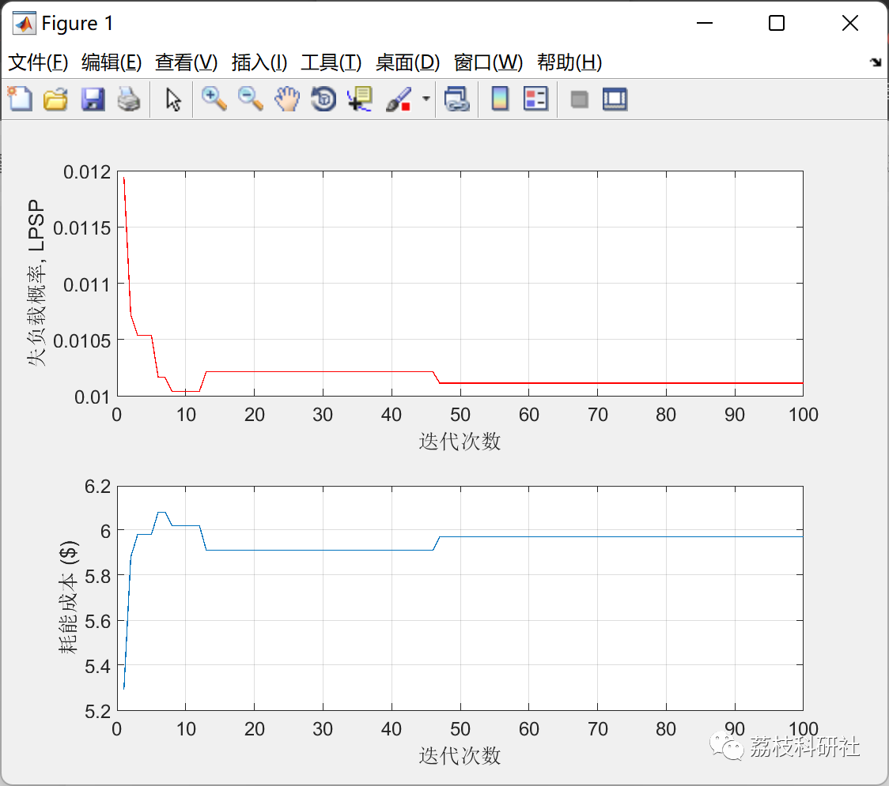

# Independent Photovoltaic-Battery-Diesel Generator Selection Based on COE and LPSP Particle Swarm Optimization (Matlab Code Implementation)

💥💥💞💞 Welcome to this blog❤️❤️💥💥
🏆 Bloggers' Advantages: 🌞🌞🌞 The content of the blog strives for rigorous thinking and clear logic to facilitate readers.
⛳️ Mantra: "Those who travel a hundred miles may be half way there."
Litchi Research Society
Code Collection: Power Systems, Intelligent Algorithms and Applications, Neural Network Prediction, Path Planning, Optimized Scheduling, Workshop Scheduling, Image Processing, Signal Processing...
🎁 Special Section Links:
🌈🌈🌈🌟🌟🌟 Electrical Code Intelligent Algorithms and Their Applications Path Planning Neural Network Prediction Optimized Scheduling Image Processing Workshop Scheduling Signal Processing Romantic Her Thoughts Math Modeling Complete Code Issues
💥1 Overview
This article is based on the selection of independent photovoltaic-battery-diesel generator systems using Particle Swarm Optimization (PSO) based on energy cost (COE) and supply probability loss (LPSP), and it is implemented in Matlab code.
📚2 Run Results
🎉3 References
[1] Razman Ayop (2022). PV-Battery-DG Sizing using Particle Swarm Optimization (PSO)
🌈4 Matlab Code Implementation
Click the article below left [Read Full Content]

## Images

<!-- PAYMENT_BLOCK -->

## Get this dataset

- Payment link (Stripe): [Buy now](https://buy.stripe.com/3cs8yP7sY87d0vu9AB)
- Payment QR code: 

<!-- /PAYMENT_BLOCK -->
